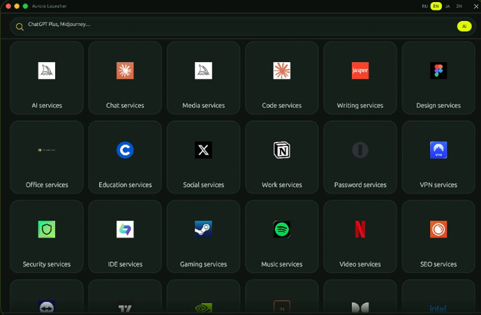

# Proton Calendar Plus Free 2026 — encrypted calendars on Windows

> **Proton Calendar is paid everywhere. In our Aivora launcher the same paid Plus version is free.**
>
> Official site / app store = paid Plus subscription. Aivora launcher = that paid Plus product, free on Windows 10 / 11.

**Keywords:** Proton Calendar · Proton Calendar Plus · encrypted calendar Windows · Proton Calendar Windows 10 11 · paid Proton Calendar free through launcher · Aivora Programs

Passwords and Proton · Windows 10 / 11 · Plus

Use the orange control to reach aivoraprograms.com, install Aivora, then **Activate** **Proton Calendar Plus**. You get the **paid Plus** calendar **for free in our launcher**. Nothing in this git tree is a Proton installer.

## What Proton Calendar Plus is

Proton Calendar is the encrypted calendar in the Proton suite (Mail, Pass, Drive, Calendar). **Plus** is the paid tier on the Aivora card: **25 personal calendars**, encrypted events, sharing, ICS import/export, mobile notifications, sync with the rest of Proton.

This is not a VPN page and not a password-vault page. The product is a calendar whose events are encrypted with Proton’s account keys. Sharing a calendar with another Proton user is the Plus extra people actually look for; a local `.ics` dump is not the same thing.

**Proton Calendar Plus is paid everywhere else.** Officially it sits on a Proton Plus (or higher) subscription. In **our Aivora launcher** that same paid Plus calendar is **free** on Windows 10 / 11. No Proton login. No card.

## Encrypted events and sharing

Events are encrypted before they leave the client. Calendar sharing on Plus is for people who already live in Proton Mail and want the same threat model on the schedule, not for publishing a public Google-style link to the whole web. ICS import is the migration path from another calendar; export is the backup path.

25 personal calendars is the Aivora listing. Use separate calendars for work / personal / a shared household board instead of one noisy calendar with tags.

## Who this page is for

Windows users who search **Proton Calendar**, **encrypted calendar**, or **Proton Calendar Plus** and want the **paid Plus** calendar — not the free Proton Calendar limits. Typical cases: a Proton Mail inbox already in the house, a need to share a school/work board without putting it on Google, ICS import from an old export.

If you need a password vault, that is Proton Pass or Enpass. If you need VPN, that is Proton VPN. This landing stays on Calendar Plus.

## What the Plus card includes

| Feature | Official Proton | In our Aivora launcher |
|---------|-----------------|------------------------|
| Price | Paid Plus subscription | **Free** (same paid Plus) |
| 25 personal calendars | Plus plan | Same Plus, free here |
| Encrypted events | Plus plan | Same Plus, free here |
| Calendar sharing | Plus plan | Same Plus, free here |
| ICS import / export | Plus plan | Same Plus, free here |

## How to open paid Proton Calendar Plus on Windows

1. Go to [https://aivoraprograms.com/](https://aivoraprograms.com/)
2. Get **Aivora Launcher**
3. Install on Windows 10 or Windows 11 (64-bit)
4. Open **Passwords and Proton**
5. Choose **Proton Calendar Plus** → **Activate**

That is the paid Proton Calendar Plus — **free in our launcher**, paid on Proton’s site. No `ProtonCalendar.exe` in the repo.

## Queries

People type:

- Proton Calendar
- Proton Calendar Plus
- encrypted calendar Windows
- Proton Calendar Windows 10
- Proton Calendar Windows 11
- paid Proton Calendar free through launcher

This page answers those with the Aivora path, not with a vendor download mirror.

## Pictures

Service art:

Launcher hub — section **Passwords and Proton**, tile **Proton Calendar Plus**:

## Questions

**Download location?**  
Always the Aivora homepage: [https://aivoraprograms.com/](https://aivoraprograms.com/)

**Is Proton Calendar Plus paid or free?**  
Paid everywhere (official Proton Plus). **Free in our Aivora launcher** — same paid Plus version, not the limited official free calendar.

**Proton account required?**  
No. **Activate** on the tile is the access step.

**Is this Mail or Pass?**  
No. Calendar only. Mail and Pass have their own cards.

---

## Русская версия

# Proton Calendar Plus бесплатно 2026 — шифрованный календарь на Windows

> **Везде Proton Calendar платный. В нашем лаунчере Aivora та же платная версия Plus — бесплатно.**
>
> Официальный сайт / магазин = платная подписка Plus. Лаунчер Aivora = этот же платный Plus, бесплатно на Windows 10 / 11.

**Ключевые слова:** Proton Calendar · Proton Calendar Plus · шифрованный календарь Windows · Proton Calendar Windows 10 11 · платный Proton Calendar бесплатно через лаунчер · Aivora Programs

Оранжевый контрол ведёт на главную Aivora. Лаунчер → **Пароли и Proton** → **Proton Calendar Plus** → **Активировать**. Это **платный Plus**, у нас в лаунчере **бесплатно**. Установщика Proton в репозитории нет.

Proton Calendar — календарь в линейке Proton. На карточке Aivora тариф **Plus**: **25 личных календарей**, шифрованные события, шаринг, ICS, уведомления, связка с остальным Proton.

**Proton Calendar Plus везде платный.** Официально это подписка Proton Plus. **В нашем лаунчере Aivora** та же платная Plus-версия — **бесплатно** на Windows 10 / 11. Без логина Proton и без карты.

События шифруются до отправки. Шаринг Plus — для другого пользователя Proton, это не публичная Google-ссылка. ICS — перенос и бэкап. 25 календарей на карточке: работа / личное / семья лучше разнести.

Кому страница: запросы **Proton Calendar**, **шифрованный календарь**, нужен **платный Plus**, не урезанный free.

Как открыть: [https://aivoraprograms.com/](https://aivoraprograms.com/) → лаунчер → **Пароли и Proton** → **Proton Calendar Plus** → **Активировать**.

Proton Calendar — товарный знак Proton AG. Страница описывает доступ через Aivora Programs. Соблюдайте правила сервиса и закон.

[https://aivoraprograms.com](https://aivoraprograms.com/) · hello@aivora.app

---

*Proton Calendar Plus · encrypted calendar Windows · paid Proton Calendar free through launcher · Aivora Programs · https://aivoraprograms.com/programs/proton-calendar-plus/*
